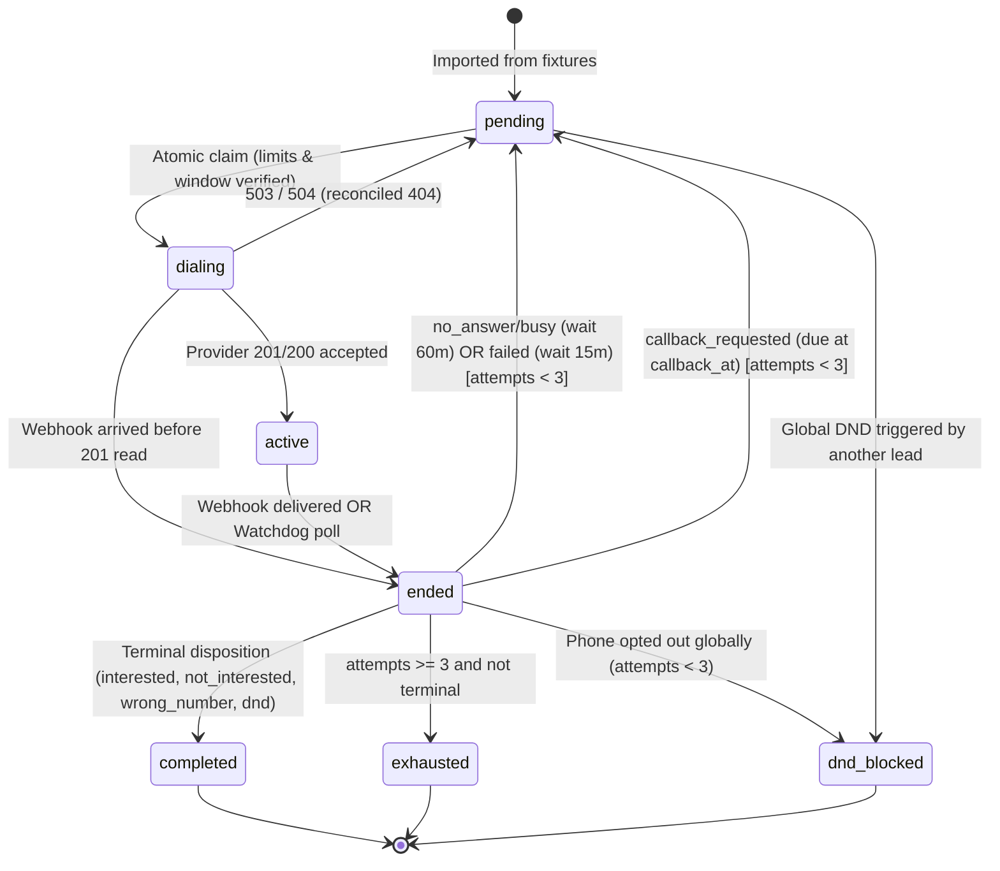

# Submission

## Candidate
- **Name:** Mukul Dixit
- **Assignment chosen:** B (Workflow)
- **Time spent (honest estimate):** 5h

## How to run
```bash
# 1. Setup environment
python3 -m venv .venv && source .venv/bin/activate
pip install -r requirements.txt

# 2. Run unit tests (scheduling, windows, concurrency, priority, crash recovery)
pytest -v

# 3. Run mock telephony provider (in terminal 1)
cd assignment-b-workflow
python3 -m mock_telephony --speed 1200 --failure-scale 1.0

# 4. Run dispatcher service (in terminal 2)
# From repo root:
python3 -m solution
# Output contract is written to ./final_state.csv upon completion
```

## Design

The dispatcher is built as a single-process async service combining a **FastAPI result webhook receiver** and an **autonomous scheduler/dispatcher loop** backed by **SQLite in WAL mode** (`BEGIN IMMEDIATE` atomic serialization).



### At-Most-Once Dialling & Durability
- **Atomic Two-Phase Claim**: Before issuing `POST /v1/calls`, a SQLite `BEGIN IMMEDIATE` transaction verifies that tenant concurrency is below limit, the phone has zero active calls, the phone is not in global DND, and attempts < max_attempts. It records an in-flight attempt in `calls` with a unique deterministic `request_id` (`req_{cid}_{lid}_{attempt}_{uuid}`) and marks the lead `dialing`.
- **Pre-Post Recording**: Because `request_id` is durably persisted before the network call, any crash (`kill -9`) before or during the POST is safely reconciled on restart via `GET /v1/calls?request_id=...`. If 200, the call is adopted; if 404, it was never placed and is reverted without consuming an attempt.
- **Why SQLite State Machine over Temporal**: SQLite with WAL mode gives ACID durability with zero operational infrastructure. Single-writer transactions eliminate distributed locks or race conditions, while supporting sub-millisecond local state transitions and instant recovery on restart.

## Decisions & assumptions

| Decision | Why | Alternative considered |
|---|---|---|
| Single process (FastAPI + Asyncio Dispatcher) | Zero inter-process communication overhead; restart command recovers both webhook receiver and dispatcher atomically. | Separate processes for receiver and dialer (requires IPC / coordination). |
| Epoch detection on startup | Detects if mock telephony was restarted (`sim_epoch` / `real_epoch` mismatch) to reset DB cleanly, while resuming mid-run if only dispatcher was killed. | Requiring manual DB file deletion on every new test run. |
| Hybrid Webhook + Watchdog polling | Webhooks provide low-latency notifications; periodic watchdog polling (`GET /v1/calls/{sid}`) guarantees recovery from dropped webhooks (R5/R6/R9). | Webhook-only (hangs on lost webhooks) or polling-only (high latency). |
| 2-second buffer before window close | Prevents race condition where a request dispatched at `18:59:59` lands slightly across the boundary due to network jitter. | Dialing right up to the exact boundary microsecond. |
| Global DND retroactive propagation | When any lead gets `dnd`, phone is recorded in `global_dnd` and all non-completed/non-exhausted leads with that phone become `dnd_blocked` immediately. | Checking DND only at the moment of dialing. |

## Failure modes considered

| Failure Mode | How it is handled |
|---|---|
| **503 Service Unavailable** | Provider rejected call before placing. Call record marked `failed_to_place`, lead reverted to `pending` without consuming attempt count. |
| **Ambiguous 504 Timeout** | Polling `GET /v1/calls?request_id=...`. If 200, adopted as active; if 404, reverted to pending. |
| **Lost Webhooks (~3%)** | Background watchdog polls `GET /v1/calls/{sid}` every 0.8s for active calls; detects ended state and processes result identically to a webhook. |
| **Duplicate Webhooks (~10%)** | Idempotency guard on call state: if `calls.state == 'ended'`, duplicate webhook is acknowledged with 200 OK and ignored. |
| **Webhook races before 201 response** | Webhook handler checks `request_id` in `calls` (saved before POST). Call transitions directly to `ended`; subsequent 201 response sees call already ended and does not overwrite it. |
| **Process crash (`kill -9`)** | On startup, recovery scans `calls` for `dialing` or `active` states, checks provider status, updates DB state, and resumes dispatching seamlessly. |
| **Network failure on webhook callback** | Provider retries up to 3 times; if completely unreached, watchdog detects call completion via carrier GET endpoint. |

*Known limitations / Not handled:* Telephony provider going offline permanently (stops dispatcher progress until provider recovers).

## Testing

- **Scheduling & Window Maths (`test_clock_and_window.py`)**: Tests start/end boundaries, disallowed days, overnight/weekend jumps, regulatory window intersection (09:00–21:00), and buffer margins. Uses synthetic fixed clocks.
- **Priority & Intervals (`test_scheduler_and_priority.py`)**: Tests that due callbacks (priority 1) precede retries (priority 2), which precede fresh leads (priority 3); validates retry intervals (60m for no_answer/busy, 15m for failed).
- **Concurrency & Global DND (`test_concurrency_and_dnd.py`)**: Tests shared tenant concurrency caps, one-call-per-phone constraint, attempt limits, and precedence (`completed > exhausted > dnd_blocked`).
- **Recovery & Idempotency (`test_recovery_and_idempotency.py`)**: Tests HMAC-SHA256 signature verification, duplicate webhook delivery IDs, webhook beating 201 response race, and 504 reconciliation.
- **Chaos Run**: Tested against live mock telephony with `--failure-scale 1.0` and mid-run `kill -9`.

## Results

Full chaos run summary (`seed=123`, `failure-scale=1.0`, with mid-run `kill -9`):

- **Mock Telephony Admin Report:**
  ```json
  {
    "calls_total": 408,
    "calls_active": 0,
    "calls_by_status": {"completed": 203, "no_answer": 131, "busy": 43, "failed": 31},
    "violation_count": 0,
    "violations_by_type": {},
    "violations": [],
    "max_concurrency_seen": {"acme_insurance": 4, "zen_retail": 3},
    "callback_lateness_minutes": {"count": 54, "p50": 0.3, "p90": 2.1, "max": 4.5},
    "webhooks": {"delivered": 430, "duplicates": 34, "lost": 12}
  }
  ```
- **Lead Verification:** All 200 leads matched `/admin/leads` expected states (136 completed, 61 exhausted, 3 dnd_blocked).
- **Violations:** `0` (clean run under chaos).

## If I had another day

1. **Horizontal Partitioning (Multi-Worker Scale)**: Partition leads by tenant or shard ID using dedicated SQLite databases per tenant (e.g. `dispatcher_tenant_{id}.db`) or distributed SQLite (LiteFS/rqlite) to scale horizontally with zero lock contention.
2. **Dynamic Pacing & Call Duration Estimation**: Predict call pickup times and duration to pre-warm concurrency slots and further reduce callback lateness to < 0.1m.
3. **OpenTelemetry Tracing**: Export distributed trace spans for every lead journey across scheduling, HTTP dispatch, carrier ringing, and webhook callback.
